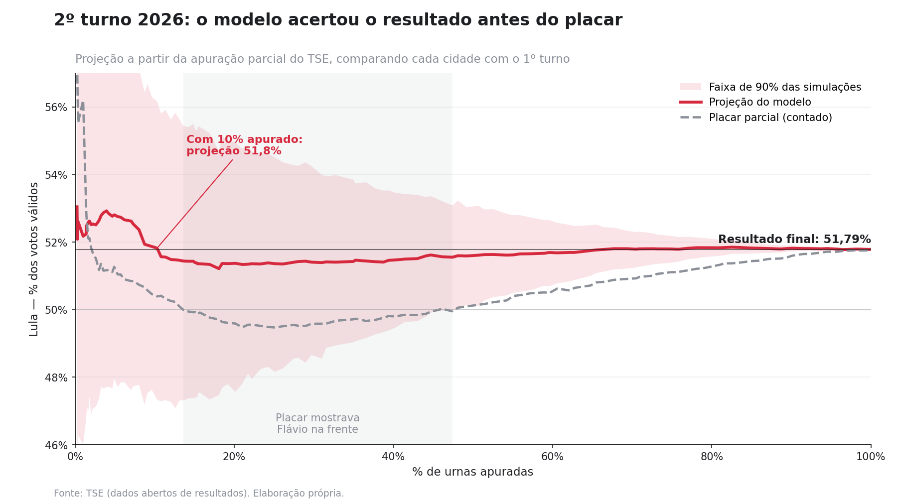

# Projeção ao vivo do 2º turno — Eleição presidencial 2026

Modelo que projeta o resultado final da eleição a partir da apuração parcial do TSE,
atualizado a cada minuto durante a noite de 25/10/2026.



**Resultado:** Lula 51,79% (64.256.232 votos) × Flávio Bolsonaro 48,21% (59.826.041).

| Urnas apuradas | Placar parcial (Lula) | Projeção do modelo | Faixa de 90% |
|---|---|---|---|
| 10% | 50,39% | 51,82% | 47,3% – 56,2% |
| 30% | 49,58% | 51,39% | 48,5% – 54,0% |
| 50% | 50,14% | 51,61% | 50,1% – 53,1% |
| 70% | 50,93% | 51,79% | 51,2% – 52,3% |
| 90% | 51,60% | 51,82% | 51,7% – 51,9% |

Entre ~14% e ~47% das urnas o placar parcial mostrava o Flávio na frente; o modelo
manteve o Lula em torno de 51,4% o tempo todo.

## Por que não usar o placar parcial

As urnas não chegam em ordem aleatória: algumas regiões são apuradas antes de outras,
e o candidato mais forte nelas parece estar ganhando por horas. O modelo não projeta a
partir do placar, e sim da **mudança** de cada cidade em relação ao 1º turno.

## Como o modelo funciona

Duas projeções rodam lado a lado, para comparação:

**Projeção simples** (`projetar.py`): cada cidade termina com a mesma proporção de
votos que já apurou; cidade sem nada apurado segue os votos por eleitor do seu estado
(ou do Brasil, enquanto o estado tiver menos de 1% apurado).

**Projeção pelo 1º turno** (`modelo_v2.py`), a do painel:

1. Para cada cidade apurada, compara a fatia do Lula entre os dois candidatos no 1º e
   no 2º turno (em logit) e ajusta uma regressão nacional ponderada por votos:
   `2º turno = α + β · 1º turno`. Com menos de 30 cidades apuradas, usa β = 1 (a mesma
   mudança em todas as cidades).
2. **Efeito de estado:** desvio médio das cidades do estado em relação à regressão,
   encolhido quando há poucas cidades apuradas (`m / (m + 10)`).
3. **Cidades parcialmente apuradas:** o que falta segue o modelo, corrigido pelo desvio
   que a própria cidade já mostrou, com peso crescente conforme as urnas chegam.
4. **Votos que faltam:** proporcional ao eleitorado ainda não apurado; em cidade sem
   apuração, válidos do 1º turno × comparecimento relativo observado no 2º.
5. **Incerteza:** 2.000 simulações por atualização (semente fixa, reprodutível),
   variando a regressão (bootstrap das cidades), o efeito de cada estado, um ruído por
   cidade e um choque nacional que encolhe conforme a apuração avança. Daí saem a faixa
   de 90% e a chance de vitória.

Foram 289 atualizações na noite, cerca de 580 mil simulações.

Limites conhecidos: a incerteza de comparecimento não entra nas simulações, e o tamanho
do choque nacional é premissa, não estimado do dado.

## Problemas de dado tratados

- Arquivos de votos por cidade às vezes vêm mais velhos que o total do estado (cache do
  TSE). A diferença vira uma linha "ATRASO" por estado, para não perder votos.
- Os votos do exterior aparecem no total nacional antes dos arquivos por cidade; até o
  total do exterior sair, entram como resíduo (Brasil − estados).
- Cada snapshot é marcado como completo ou incompleto; o histórico só usa os completos.

Vários desses problemas foram achados por um agente revisor
([`.claude/agents/anticlaude.md`](.claude/agents/anticlaude.md)), rodado no
[Claude Code](https://claude.com/claude-code) com uma única missão: recalcular os
números por conta própria e tentar derrubar o código.

## Como rodar

Python 3.12, `pip install -r requirements.txt`.

```
py baixar_1turno.py      # uma vez: resultado do 1º turno por cidade (~5,7 mil arquivos)
py coletar.py            # durante a apuração: snapshot do TSE a cada minuto
py projetar.py --loop    # em paralelo: projeta a cada snapshot novo
py grafico_linkedin.py   # depois: gráfico placar × projeção
```

Saídas em `saida/` (no repositório estão as da noite de 25/10; o `historico.csv` não
pode ser regenerado sem os snapshots, que não sobem):

- `historico.csv`: projeções minuto a minuto;
- `municipios.csv`: estado atual por cidade (gerado ao rodar, não versionado);
- `painel.html`: painel público (versão final da noite);
- `modelo.html`: detalhes técnicos.

Os CSVs usam `;` como separador e vírgula decimal.

Os endpoints do TSE (`resultados.tse.jus.br/oficial/ele2026/...`) valem para esta
eleição; outra eleição precisa trocar os códigos em `coletar.py`.

Fonte: TSE, dados abertos de resultados.
